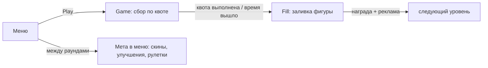

# ГДД — Mad Slime

> Главный дизайн-документ. Состояние на 2026-10-16, ветка `main` — все числа сверены с конфигами и кодом. Детали реализации — карточки в папке `Модули`; правила кода — `Wiki/AI_RULES.md`.

## 1. Паспорт

| | |
|---|---|
| **Название** | Mad Slime |
| **Жанр** | казуальная аркада «пожиратель» + мета-петля (апгрейды, перки, скины, рулетки) |
| **Платформа** | WebGL, Яндекс.Игры (YG2 SDK) |
| **Движок** | Unity 2022.3.62f2 LTS, 3D low-poly, uGUI (портрет 1080×1920) |
| **Сессия** | раунд ~1.5–2 мин (90 с на сбор + заливка) + мета в меню |
| **Ориентир монетизации** | interstitial между раундами + 3 rewarded-входа |
| **Сцены** | `Menu`(0) → `Game`(1) → `Fill`(2), аддитивные переходы через [[SceneNavigator]]; мета (скины/улучшения/рулетки) — окна внутри Menu, отдельной сцены Shop нет; `Test.unity` — только на диске |
| **Языки** | ru / en / tr (ru — источник, фолбэки tr→en→ru) |

## 2. Ядро игры (одна фраза)

Слизень ест предметы и растёт: сначала поедает только мелочь, с ростом открывает более крупные тиры, выполняет квоту «съешь N штук таких-то» до конца таймера — и заливает фигуру кубиками ради монет, которые тратит на апгрейды, перки и скины в меню.

## 3. Основной цикл

Полный круг: **сбор → заливка → деньги → усиление → сбор сложнее**. Уровни берутся из каталога диапазонов; прогресс уровня, максимальный уровень, монеты и всё мета-состояние живут в сейве YG2 ([[SavesYG]]).

## 4. Сессия Game — «ешь предметы»

### Управление
WASD / геймпад-стик / виртуальный джойстик (появляется в точке касания). Раунд стартует **замороженным** — первый ввод движения запускает таймер и аналитику ([[GameplayOrchestrator]]).

### Рост по тирам
- Тиры: `Small → Medium → Large → Huge → Giant → Boss` ([[TierTable]] задаёт масштаб и массу каждого)
- Масса предметов копится в массу игрока ([[Рост игрока]]); пороги масс из [[PlayerConfig]] открывают следующий тир: модель и коллайдер плавно растут (овершут-анимация), камера отъезжает, скорость обновляется
- Есть только то, что **не выше твоего тира**; на тир выше — с перком Ambitions. Слишком крупные вплотную становятся **призраками** (dither-полупрозрачность) — не мешают обзору
- Радиусы «рта», магнита и зоны клампа масштабируются с тиром игрока

### Магнит и поедание
Предметы в радиусе магнита сами текут к слайму по спирали (разгон у «рта», орбитальный свёрл), у рта — дуга полёта в пасть (Безье, вращение, сжатие), при поедании — squash и звук с растущим питчем. Камера «дышит»: подтяжка от массы съеденного, шейк от тяжёлых предметов, толчок и FOV-кик на тир-апе.

### Квота
- Случайная генерация из того, что реально заспавнено: 1–3 типа × 3–8 штук, максимум 2 типа на один тир (квота всегда выполнима и не вся из мелочи) — [[Квота]]
- Квотные предметы дают повышенную массу и «заливку»; посторонние — обычную массу и заливку за Метаболизм
- Выполнил квоту → сразу в Fill. Таймер (90 с) вышел → тоже в Fill, но с тем, что успел

### Финальный отсчёт
Последние 20 с: ползок ускоряется (urgency), тикает таймер, включается виньетка; с перком **Adrenaline** — ещё и разгон скорости.

### Перки в геймплее
| Перк | Эффект |
|---|---|
| Smell («Нюх») | квотные предметы подсвечены (Outline) |
| Adrenaline | множитель скорости (×2) на финальном отсчёте |
| Ambitions («Амбиции») | можно есть на 1 тир выше своего |

## 5. Сессия Fill — «залей фигуру»

Форма уровня — из текстуры темы ([[Конфиги уровней | LevelTheme]]): растр → сетка → **бордюр выстраивается каскадом**, затем фигура заливается кубами ([[Заливка фигуры]]):
- **квотные кубы** — цветами пикселей текстуры (сколько = доля квоты из Game)
- **бонусные кубы** — с тинтом (за «посторонние» предметы, усиленные Метаболизмом)
- **тап №1** — ускорение заливки; **тап №2** — мгновенный залп остатка (0.25 с)
- Недолил → FailMenu: утешительные монеты (если залил ≥ 25%) + **спасение за рекламу** (долить остаток)
- Залил 100% → конфетти цветами фигуры, пунш формы, FOV-кик → WinMenu: награда + кнопка **×2 за рекламу**
- Любой уход из Fill — interstitial ([[FillSceneOrchestrator]])

## 6. Экономика

Валюта одна — **монеты**. Стартовый баланс нового игрока: 250.

### Источники
| Источник | Сколько |
|---|---|
| Победа в Fill | **50 × 1.27^(уровень−1)**, потолок 5000 ([[RewardConfig]]) — доход растёт с прогрессом |
| Утешение при провале (заливка ≥ 25%) | награда уровня / 4; ниже — 0 |
| Ежедневная рулетка, секторы монет | 50 / 150 / 300 / 600 / 1000 / 1500 / 3000 (шансы 35 / 25 / 15 / 10 / 7 / 4 / 3%) |
| Rewarded ×2 | +100% к победе |

### Стоки
| Сток | Цена |
|---|---|
| Апгрейды (4 шт × 5 ступеней) | base 200 / 250 / 400 / 350, **×2 за ступень** ([[UpgradesConfig]]) |
| Перки (3 шт, навсегда) | 3000 / 4000 / 5000 |
| Платная крутка ежедневной | 100 |
| Скин-рулетка | 300 + 150 × счётчик круток, **потолок 3000** |

### Баланс
Доход теперь растёт геометрически с уровнем и подпирает дорожающие стоки: цены апгрейдов удваиваются за ступень, но и награда удваивается каждые ~3 уровня. На дистанции оба упираются в потолки (награда 5000, скин-рулетка 3000) — эндгейм достижим, «вечная рутина» снята.

## 7. Мета-петля

### Апгрейды (ступенчатые, 5 ступеней)
| Тип | Эффект за ступень |
|---|---|
| Speed | +10% скорость |
| Appetite | +15% масса за любой предмет |
| Taste | +20% масса за **квотный** предмет (умножается с Appetite) |
| Metabolism | +15% «заливки» за посторонние предметы → больше бонусных кубов |

### Перки (одноразовые, навсегда)
Smell 3000 · Adrenaline 4000 (×2 скорость) · Ambitions 5000 (+1 тир) — эффекты в таблице выше.

### Скины
13 скинов в каталоге ([[Скины]]); идентификация по строковому `Id` = ключу сейва. Редкости Common / Rare / Epic / Legendary; Legendary — **только из ежедневной рулетки** (сектор Skin, 1%).
- Покупка скина — только через скин-рулетку за монеты
- Ролл: витрина на колесе ([[Рулетки | SkinShowcase]]: 2 epic + 2 rare гарантированно), шанс редкости 65 / 25 / 10 / 0; открытые исключаются; дубликат эксклюзива — компенсация 100 монет; все обычные собраны — компенсационные секторы
- Экипировка: окно «Скины» в меню → превью с поворотом → выбор пишется в сейв, применяется при входе в Game; выбранный скин показывает и загрузочный экран

### Рулетки ([[Рулетки]], настройка — [[Конфиги скинов и рулетки]])
- **Ежедневный приз** (из меню): автопоказ раз в сессию + кнопка; фри-спин раз в 30 мин; до 3 спинов за рекламу в скользящем окне 30 мин; платные крутки за 100 всегда
- **Скин-рулетка** (окно «Скины»): только за монеты; цена растёт на 150 с круткой до потолка 3000
- Обе — круговое колесо: idle-вращение, спин 5–25 оборотов / 6 с, финал — выбег мимо ячейки + щелчок-возврат

## 8. Прогрессия уровней

- `LevelsCatalog`: диапазоны «уровни X–Y → свой LevelConfig» (тема, набор предметов, тир-диапазон, таймер 90 с, параметры квоты). Новый контент = правка ассетов, код не трогается ([[Конфиги уровней]])
- Внутри уровня раскладка случайна: LayoutSet из библиотеки, 6 форм зон (решётка, круг, кольца, рассыпание, квадратный периметр, квадратный хаос), SingleType-зоны, независимое зеркалирование X/Z, предметы Large+ становятся препятствиями для раскладки ([[LevelGenerator]])
- `CurrentLevel`/`MaxLevel` в сейве; лидерборд — накопительное количество поглощённых предметов за всё время ([[Лидерборды]])

## 9. Монетизация

| Слот | Где | Триггер |
|---|---|---|
| Interstitial | выход из Fill (все исходы) | каждый переход, капа на стороне проекта нет — держится на плагине |
| Rewarded ×2 | WinMenu | удвоение награды |
| Rewarded «спасение» | FailMenu | долить заливку после провала |
| Rewarded «спин» | ежедневная рулетка | до 3 круток в окне 30 мин |

Пауза на рекламе — внутри плагина; игра уважает `IsPauseGame` ([[Pauser]]). Аналитика: GameplayStart/Stop на каждую сессию. Запись очков — только авторизованным (диалог авторизации — в окне лидерборда).

## 10. Сохранения и платформа

Весь прогресс — сейв YG2 (`SavesYG`, JsonUtility): уровень, счётчик съеденного, баланс, скины (+витрина), апгрейды, перки, рулеточные таймеры, громкости, язык. Сохранение — по событиям через транзакции `Saver` с откатом при падении ([[Saver]]), сцена не стартует, пока сейв не подтверждён. Дефолты нового игрока: уровень 1, 250 монет, Slime открыт и надет. Платформа — только через шов интерфейсов ([[Интерфейсы Core (шов YG2)]]), адаптеры — [[YG2-адаптеры]].

## 11. Звук и представление

Музыка сцена-специфичная (плейлисты Menu/Game/Fill) с кроссфейдом двух источников. SFX — раздельные пулы голосов UI и геймплея ([[Аудио-подсистема]]). Громкости — в настройках (окно Settings = PauseMenu без кнопки выхода). Ключевые ощущения — звуковые: питч пикапа, тик таймера на финальном отсчёте, щелчок колеса рулетки, питч кубов растёт с заполнением, фанфара приза.

## 12. Карта экранов

| Экран | Содержимое |
|---|---|
| **Menu** | Play, Ежедневный приз (попап рулетки), Лидерборд (топ-10 + авторизация), Настройки (звук), смена языка; окна: **Скины** (витрина + превью + скин-рулетка) и **Улучшения** (4 апгрейда + перки) — [[Меню]] |
| **Game** | HUD скрыт до первого ввода: таймер, тарелки квоты, полоса роста с тиром; пауза (продолжить / звук / в меню) |
| **Fill** | % заливки, тап по экрану ускоряет; Win/Fail окна |

## 13. Ссылки

- Реализация: карточки модулей — `Wiki/Модули/` ([[SceneNavigator]], [[Меню]], [[Квота]], [[Рулетки]], [[Магазин]], [[Лидерборды]] и др.)
- Правила кода: `Wiki/AI_RULES.md`
